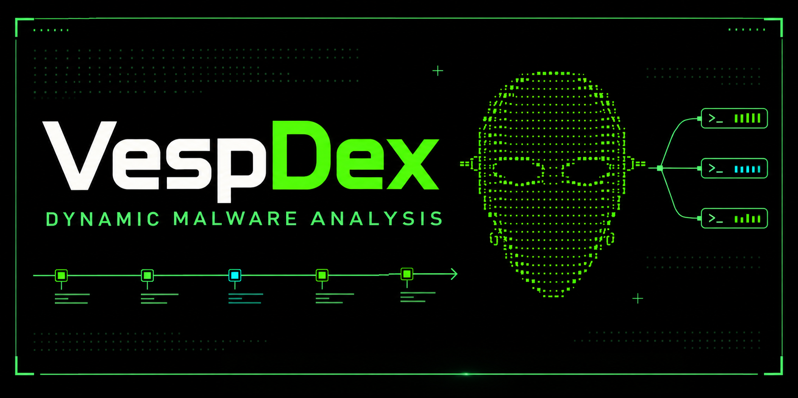

<p align="center">
  
</p>

# VespDex

**A local runtime telemetry analyzer written in Rust.** VespDex turns Windows Sysmon recordings and v1 JSON captures into searchable event timelines, process trees, and portable behavior reports.

[Download for Windows x64](https://github.com/dRafaleD/VespDex/releases/tag/v0.3.0-rc.1) · [Türkçe](README.tr.md) · [Behavior report v1](docs/BEHAVIOR_REPORT_V1.md) · [Changelog](CHANGELOG.md) · [ISC License](LICENSE)

## What you can do

- **Inspect a recording.** Open an exported Sysmon EVTX or a JSON capture in the Windows desktop app. Filter by event type, process, or text. Expand events to inspect and copy their details.
- **Follow a process tree.** Select a Sysmon process with a recorded SHA-256 to review its events and recorded descendants. The report identifies missing parent or start records and shows which event types were observed.
- **Export a behavior report.** Save versioned JSON from the desktop, terminal workspace, or CLI. Exports use a new filename and preserve existing files.

VespDex reads recorded activity and can collect a time window from an existing local Sysmon log. It does not launch samples. Event counts describe the available recording, and the report provides no malware verdict.

## Install

### Windows x64 portable package

Download the ZIP and `SHA256SUMS.txt` from [Releases](https://github.com/dRafaleD/VespDex/releases). Before extracting, compare the digest with the value in the checksum file:

```powershell
Get-FileHash -Algorithm SHA256 .\VespDex-0.3.0-rc.1-windows-x64.zip
```

Extract the ZIP and open **Start-VespDex.cmd**, then select **Örnek kaydı aç** for the built-in synthetic recording.

The current package is an **unsigned pre-release** verified on Windows 11 Pro x64 and Windows Server 2025 x64. The desktop requires a Direct3D 12 hardware or Windows software adapter. The CLI is also checked on Linux. Recent desktop improvements and the Dark, Graphite, Midnight, and High Contrast themes are available from the `main` source branch.

### Build from source

With the stable Rust toolchain installed:

```sh
git clone https://github.com/dRafaleD/VespDex.git
cd VespDex
cargo install --path . --locked
```

On Windows, run `vespdex --gui`. Use the header language menu to choose **English** or **Türkçe**. The language and theme preferences are stored locally for the Windows account.

## Usage

| Task | Command |
| --- | --- |
| Open the Windows desktop with example data | `vespdex --gui --demo` |
| Open the interactive terminal workspace | `vespdex` |
| Print the synthetic report as JSON | `vespdex --demo` |
| Analyze a capture and save a JSON report | `vespdex capture.json --output behavior.json` |
| Reopen a saved behavior report | `vespdex behavior.json` |

In the desktop, **Ctrl+O** opens a recording, **Ctrl+F** focuses timeline search, **Ctrl+S** saves the report, and **Esc** cancels an active import. In the terminal workspace, use `help` to list commands and `lang tr` or `lang en` to switch languages.

The current source build opens saved v1 behavior reports in the desktop, terminal and CLI. It rebuilds counts, process relationships and coverage from the recorded events.

In the current Windows source build, **Görünen olayları CSV kaydet** exports the events that match your timeline filters. The JSON report export saves the complete report.
Use **İşaretle** in the event detail panel and **Yalnızca işaretliler** to review selected events. Marks belong to the open recording and are cleared when you load another recording or close the app.

Open **Karşılaştırma** and choose a second JSON capture or report to compare recorded event counts, process coverage, observation windows, and file hashes.
Select an event type in the comparison table to inspect matching events from both recordings.
Compare the recorded counts from a script with `vespdex base.json --compare other.json --output comparison.json`.

### Sysmon recordings

The desktop can open exported EVTX files on Windows without a local Sysmon installation. The recording needs Event ID 1 for the process you select, with a SHA-256 value in the `Hashes` field. Supported events are process creation (1), network connection (3), file creation or overwrite (11), registry value set (13), and DNS query (22).

The included PowerShell adapter also converts an EVTX file or reads a bounded time window from the local Sysmon channel. For live collection, Sysmon must already be configured on the analysis machine. Use the recorded process GUID and a start time before its creation. Run these examples in PowerShell 7+ from the source checkout:

```powershell
$processGuid = '11111111-1111-1111-1111-111111111111' # Replace with the recorded ProcessGuid
./scripts/convert-sysmon.ps1 -Evtx ./capture.evtx -ProcessGuid $processGuid -CaseId case-001 |
    Set-Content -Encoding utf8NoBOM capture.json
vespdex capture.json --output behavior.json
```

```powershell
$start = [DateTimeOffset]::UtcNow.AddMinutes(-2)
./scripts/convert-sysmon.ps1 -Live -StartTime $start -ObserveSeconds 30 -ProcessGuid $processGuid -CaseId live-001 |
    Set-Content -Encoding utf8NoBOM live.json
vespdex live.json --output live-behavior.json
```

The capture window, log retention, and Sysmon configuration determine what the report can show. See [Microsoft's Sysmon event reference](https://learn.microsoft.com/en-us/sysinternals/downloads/sysmon) and the [report specification](docs/BEHAVIOR_REPORT_V1.md).

## AsphDex and Banshee

VespDex emits the v1 `asphdex-behavior-report` format. The AsphDex integration matches a behavior report to an analyzed file by SHA-256. The Banshee integration extracts candidate domains and destination IPs from DNS and network events. These integrations were verified with development builds. Use builds that include the respective importer or `behavior` command. The synthetic demo uses a placeholder hash.

Reports can contain paths, domains, IP addresses, and other recorded text. Review them before sharing.

## Development and license

Run `cargo fmt --all -- --check`, `cargo clippy --all-targets --locked -- -D warnings`, and `cargo test --locked`. To build a portable ZIP on Windows, run `cargo build --release --locked` and then `./scripts/package-windows.ps1 -Binary ./target/release/vespdex.exe`. The ZIP and checksum are written under `target/dist`. See the [package guide](packaging/windows/USAGE.md) and the [release verification record](docs/RELEASE_PLAN.tr.md).

VespDex is licensed under the [ISC License](LICENSE). The AsphDex startup animation attribution is in [NOTICE](NOTICE).
