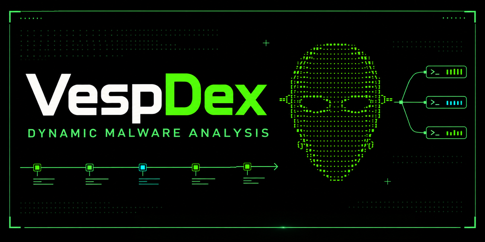

<p align="center">
  
</p>

# VespDex

**Rust ile yazılmış, yerel çalışan bir çalışma zamanı telemetrisi analiz aracı.** VespDex, Windows Sysmon kayıtlarını ve v1 JSON telemetrisini aranabilir bir olay zaman çizelgesine, süreç ağacına ve taşınabilir davranış raporuna dönüştürür.

[Windows x64 indir](https://github.com/dRafaleD/VespDex/releases/tag/v0.3.0-rc.1) · [English](README.md) · [Rapor biçimi v1](docs/BEHAVIOR_REPORT_V1.md) · [Değişiklikler](CHANGELOG.md) · [ISC Lisansı](LICENSE)

## Neler yapabilirsin?

- **Kaydı incele.** Windows masaüstünde Sysmon EVTX veya JSON aç. Olay türü, süreç ve metne göre filtrele. Olay ayrıntılarını görüntüle ve kopyala.
- **Süreç ağacını izle.** Sysmon kaydında SHA-256 değeri bulunan bir süreç seçerek kendi olaylarını ve kayıttaki alt süreçlerini incele. Rapor, kayıt içinde eksik olan süreç başlangıçlarını ve üst süreçleri gösterir.
- **Davranış raporunu kaydet.** Masaüstünden, etkileşimli terminalden veya CLI’dan sürümlü JSON al. Uygulama mevcut raporu korur ve yeni bir dosya adı ister.

VespDex kaydedilmiş etkinliği okur. Mevcut yerel Sysmon günlüğünden bir zaman aralığı da toplayabilir. Örnekleri başlatmaz. Olay sayıları kaydın kapsamını gösterir ve rapor zararlı yazılım kararı vermez.

## Kurulum

### Windows x64 taşınabilir paket

[Sürümler](https://github.com/dRafaleD/VespDex/releases) sayfasından ZIP’i ve `SHA256SUMS.txt` dosyasını indir. Arşivi çıkarmadan önce hesaplanan değeri sağlama dosyasındaki değerle karşılaştır:

```powershell
Get-FileHash -Algorithm SHA256 .\VespDex-0.3.0-rc.1-windows-x64.zip
```

ZIP’i çıkar, **Start-VespDex.cmd** dosyasını aç ve sentetik demoyu görmek için **Örnek kaydı aç** düğmesine tıkla.

Paket **imzasız bir ön sürümdür**. Windows 11 Pro x64 ve Windows Server 2025 x64 üzerinde doğrulandı. Masaüstü Direct3D 12 donanım veya Windows yazılım bağdaştırıcısı gerektirir. CLI ayrıca Linux’ta test edilir. Yeni masaüstü iyileştirmeleri ve Dark, Graphite, Midnight, High Contrast temaları `main` kaynak dalındadır.

### Kaynaktan derleme

Kararlı Rust araç zinciri kuruluysa:

```sh
git clone https://github.com/dRafaleD/VespDex.git
cd VespDex
cargo install --path . --locked
```

Windows’ta `vespdex --gui` ile aç. Sağ üstteki **Tema** menüsü görünümü değiştirir. Tercih Windows hesabında yerel olarak saklanır.

## Kullanım

| İşlem | Komut |
| --- | --- |
| Masaüstü demosunu aç | `vespdex --gui --demo` |
| Etkileşimli terminali aç | `vespdex` |
| Sentetik raporu JSON olarak yazdır | `vespdex --demo` |
| Kaydı analiz et ve raporu kaydet | `vespdex capture.json --output behavior.json` |
| Kaydedilen davranış raporunu yeniden aç | `vespdex behavior.json` |

Masaüstünde **Ctrl+O** kayıt açar, **Ctrl+F** aramaya odaklanır, **Ctrl+S** raporu kaydeder ve **Esc** süren içe aktarmayı iptal eder. Terminalde `help` ile komutları görebilir, `lang tr` veya `lang en` ile dili değiştirebilirsin.

Güncel kaynak derlemesi, kaydedilmiş v1 davranış raporlarını masaüstünde, terminalde ve CLI’da açar. Olay sayılarını, süreç ilişkilerini ve kapsam bilgisini kayıttaki olaylardan yeniden çıkarır.

Güncel Windows kaynak derlemesinde **Görünen olayları CSV kaydet** düğmesi zaman çizelgesi filtrelerine uyan olayları kaydeder. JSON dışa aktarma raporun tamamını kaydeder.

Olay sayılarını, süreç kapsamını, gözlem aralıklarını ve dosya hash’lerini karşılaştırmak için **Karşılaştırma** ekranında ikinci bir JSON kaydı veya raporu seç.
Fark tablosundan bir olay türünü seçerek iki kayıttaki ilgili olayları inceleyebilirsin.

### Sysmon kayıtları

Dışa aktarılmış EVTX dosyasını açmak için yerel Sysmon kurulumu gerekmez. Kayıt, seçilecek sürece ait Sysmon olay kimliği 1’i ve `Hashes` alanında SHA-256 değerini içermelidir. Desteklenen olaylar süreç başlangıcı (1), ağ bağlantısı (3), dosya oluşturma veya üzerine yazma (11), kayıt defteri değeri ayarlama (13) ve DNS sorgusudur (22).

PowerShell bağdaştırıcısı, EVTX’i dönüştürür ve önceden yapılandırılmış yerel Sysmon günlüğünden sınırlı bir zaman aralığı okur. [Dışa aktarılmış kayıt ve canlı toplama komutları](README.md#sysmon-recordings) kaynak dizininden PowerShell 7+ ile çalıştırılır. Raporun kapsamını gözlem aralığı, günlüğün saklama süresi ve Sysmon ayarları belirler. [Microsoft Sysmon belgesi](https://learn.microsoft.com/en-us/sysinternals/downloads/sysmon)

## AsphDex ve Banshee

VespDex, v1 `asphdex-behavior-report` biçiminde rapor üretir. AsphDex entegrasyonu davranış raporunu analiz edilen dosyayla SHA-256 üzerinden eşleştirir. Banshee entegrasyonu DNS ve ağ olaylarından alan adı ve hedef IP adaylarını çıkarır. Uyum geliştirme derlemelerinde doğrulandı. Entegrasyon için içe aktarıcıyı veya `behavior` komutunu içeren derleme gerekir. Sentetik örnek yer tutucu hash kullanır.

Raporlar dosya yolları, alan adları, IP adresleri ve başka kayıt metinleri içerebilir. Paylaşmadan önce içeriği gözden geçir.

## Geliştirme ve lisans

`cargo fmt --all -- --check`, `cargo clippy --all-targets --locked -- -D warnings` ve `cargo test --locked` komutlarıyla kaynak kodunu kontrol edebilirsin. [Paket kılavuzu](packaging/windows/KULLANIM.md) ve [yayın doğrulama kaydı](docs/RELEASE_PLAN.tr.md) ek ayrıntıları içerir.

VespDex [ISC Lisansı](LICENSE) ile yayımlanır. AsphDex açılış animasyonunun atfı [NOTICE](NOTICE) dosyasındadır.
